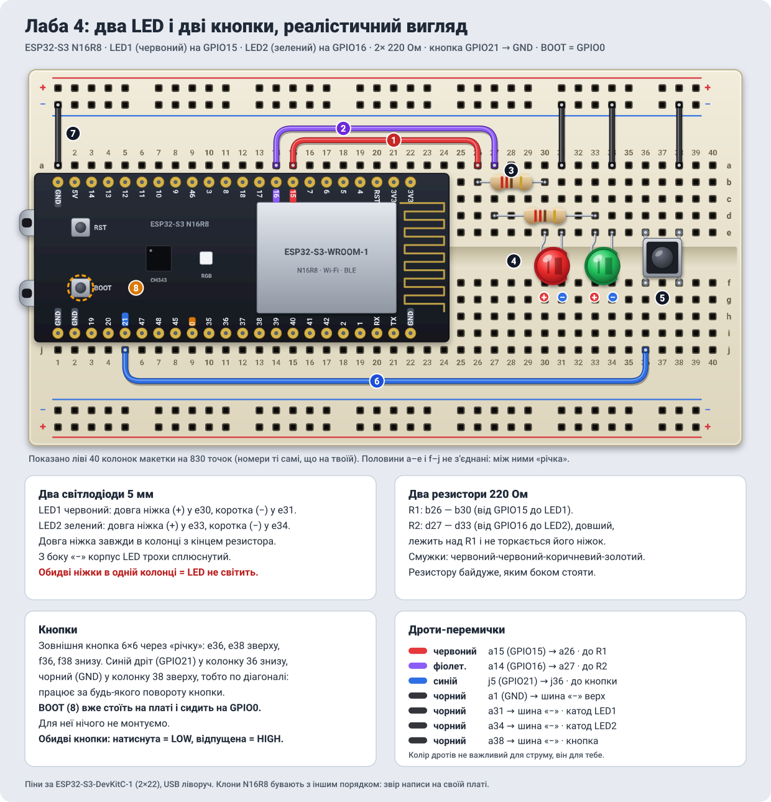

# ESP32 LED Blink

A PlatformIO project for the Freenove ESP32-S3 WROOM board using the Arduino framework. It controls two LEDs and uses two buttons to switch between blinking modes:

- **Mode 1:** Both LEDs turn on and off together every 200 ms.
- **Mode 2:** The LEDs turn on alternately, switching every second.

Button presses are checked throughout each delay, so the mode can be changed while the LEDs are blinking. Mode changes are also printed to the serial monitor at 115200 baud.

## Wiring diagram

Note: the diagram shows an external button on GPIO21 and the onboard BOOT button on GPIO0. The firmware currently reads buttons from pins 4 and 10 as defined in `src/config.h`; check the pin assignments against your wiring before running the project.
