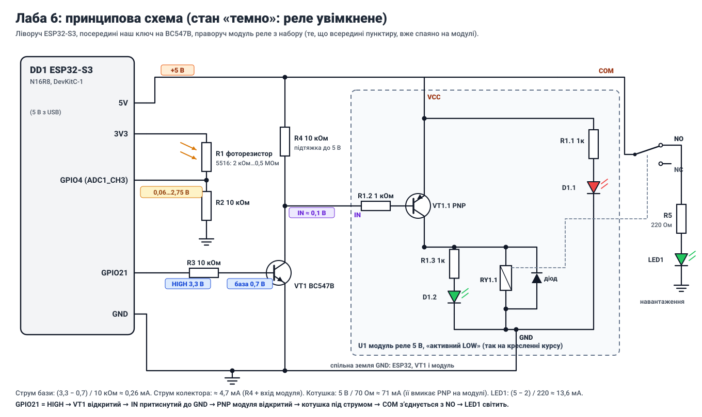
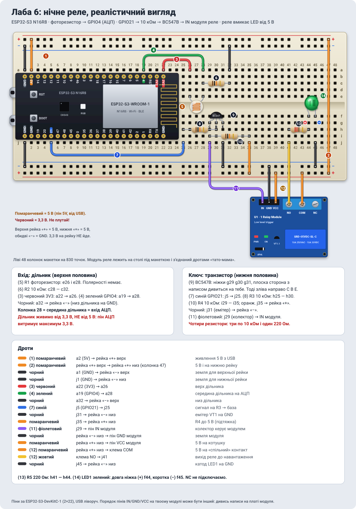

# ESP32 Light-Controlled Relay

A PlatformIO project for the Freenove ESP32-S3 WROOM board using the Arduino framework. A photoresistor in a voltage divider measures ambient light, and the board switches a relay on when it gets dark and off when it gets light again.

- **Sensor:** photoresistor (R1) and a 10 kΩ resistor (R2) form a voltage divider powered from 3.3 V. The midpoint goes to GPIO4 (ADC1_CH3), read at 12-bit resolution (0–4095).
- **Output:** GPIO21 drives the base of a BC547B transistor (VT1) through a 10 kΩ resistor (R3). The collector, pulled up to 5 V by R4 (10 kΩ), drives the IN pin of a 5 V relay module (U1). The relay switches a green LED (LED1, with a 220 Ω resistor R5) from 5 V.

The relay turns on when the ADC reading drops below `THRESHOLD_DARK` (1900) and turns off when it rises above `THRESHOLD_LIGHT` (2400). Between the two thresholds the relay keeps its current state, so it doesn't chatter at dusk. Tune both values in `src/main.cpp` for your room. `THRESHOLD_LIGHT` must stay higher than `THRESHOLD_DARK`.

The ADC value and relay state are printed to the serial monitor at 115200 baud every 200 ms, which helps when picking the thresholds.

## Schematic

The circuit in the "dark" state, with the relay on. The relay module is active-LOW, so VT1 inverts the signal: GPIO21 HIGH turns VT1 on, which pulls IN to GND (≈0.1 V) and energizes the coil, connecting COM to NO and lighting LED1. The divider runs from 3.3 V, not 5 V, so the ADC pin never sees more than about 2.75 V. The diagram also lists the expected currents: base ≈0.26 mA, coil ≈71 mA, LED ≈13.6 mA.

## Breadboard wiring

Step-by-step layout on an 830-point breadboard, with numbered wires and exact hole positions for every part. The ESP32 sits across the left side. The divider is in the upper half (column 28 is the ADC input) and the transistor switch is in the lower half. The relay module sits off the board and connects with male-to-female jumpers. Both `+` rails carry 5 V from the board's 5V pin and both `−` rails are GND; 3.3 V goes only to the divider. Check the IN/GND/VCC pin order printed on your relay module, as it can differ from the drawing.
